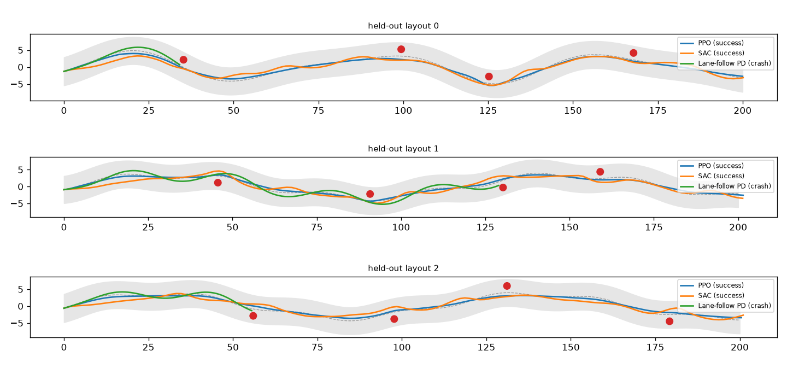
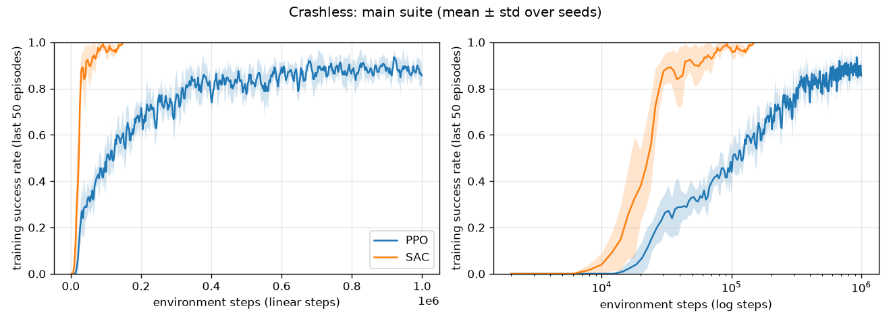

# Crashless

Reinforcement learning for lane-keeping and obstacle avoidance. PPO and SAC are implemented from scratch in PyTorch, trained in a fast custom 2D driving simulator, then transferred to the CARLA simulator through the same observation/action interface.



*Held-out 2D layouts. Red discs are obstacles. The lane-follow controller has no obstacle sensing and crashes; PPO and SAC steer around.*

## Results at a glance

| Setting | Result |
|---|---|
| 2D sim, 5 seeds, 100 held-out roads | SAC 98% ± 2% success (150k steps), PPO 93% ± 2% (1M steps), lane-follow baseline 7% |
| 2D sample efficiency | SAC reaches 80% training success in ~10x fewer steps (25k vs 242k); PPO trains ~3x faster in wall-clock time (111 s vs 354 s) |
| CARLA Town02 (the training map), 3 seeds, 100 episodes | Pretrained in 2D, then fine-tuned 30k steps: **75% ± 14%**. Trained from scratch, 30k steps: 45% ± 31%. Trained in 2D only (zero-shot): 48% ± 16%. Fine-tuning beat scratch on 3/3 seeds (one-sided sign test p = 0.125: suggestive, not significant) |

## Architecture

```
crashless/
  env.py         2D driving env (Gymnasium API): kinematic bicycle model, winding road, obstacles, 9 range rays
  ppo.py         PPO: 8 parallel envs, clipped objective, GAE with correct time-limit truncation
  sac.py         SAC: twin Q, target nets, auto entropy, replay buffer; saves critics for fine-tuning
  networks.py    Gaussian actor-critic (PPO), tanh-squashed Gaussian actor (SAC), twin Q
  baselines.py   RandomPolicy, LaneFollowPolicy (PD on lateral offset + heading, no obstacle sensing)
  evaluate.py    deterministic evaluation on held-out seeds (1,000,000+)
  logger.py      episode tracker + CSV logger
  route.py       route geometry for CARLA: projection, lateral offset, rays to road edge, lidar binning
  carla_env.py   CARLA env with the same contract as env.py
train.py         train one agent: --algo ppo|sac --env 2d|carla --seed --steps --init-from --learning-starts
scripts/         2D: benchmark.py, report.py, demo.py, reeval.py
                 CARLA: carla_check.py, carla_eval.py, carla_seeds.sh, carla_report.py
configs/         env.yaml, ppo.yaml, sac.yaml, carla.yaml, sac_carla.yaml
tests/           test_env.py, test_algorithms.py, test_route.py, test_report.py (31 tests, one swept over 200 seeds: 230 cases)
docs/            FAILURE_LOG.md, CARLA_PORT.md
results/         main.md, smoothness.md, shaping.md, carla.md (+ json, plots)
```

## Shared contract (2D and CARLA)

A test (`test_carla_config_matches_2d_contract`) keeps the shared constants in sync (dt, rays, speeds, steering), so a policy trained in one runs unchanged in the other. The reward terms are the same, but two quantities are measured differently (see the note under the table).

| | Definition |
|---|---|
| Observation (14 floats) | 9 ray distances / 25 m over a 120° field of view, lateral offset / half-width, heading error / π, speed / 15, previous steer, previous throttle |
| Action (2 floats in [-1, 1]) | steer (±1 = ±0.5 rad at the wheels), throttle (+) / brake (−) |
| Reward per step | +1 per metre of progress, −0.3·(lat/hw)², −0.1·(heading err/π)², −1.0·\|Δsteer\| |
| Terminal bonuses | −50 on crash or off-road, +20 on finishing |
| Episode | terminated on crash, off-road (\|lat\| > hw − 0.5) or finish (200 m); truncated at 400 steps; dt = 0.1 s |

**Known mismatch.**
- **Progress:** the 2D env measures progress along the x-axis (`x − x0`) and finishes at x ≥ 200 m. CARLA measures arc length along the route. On a curving 2D road, x-progress is less than the distance actually travelled.
- **Lateral offset:** in 2D it's a first-order approximation at the car's x-coordinate, not a true projection onto the centre line. Road slopes reach about 1.1 (around 48°), where the approximation is loosest. CARLA uses an exact projection (`route.Route`).

The contract test checks constants, not these measurements.

## 2D environment

- Kinematic bicycle model, wheelbase 2.5 m, speed 0–15 m/s, max acceleration 4 m/s², start speed 5 m/s.
- Road: sum of two random sinusoids, half-width 4 m; the finish is at x = 200 m.
- Obstacles: 4 discs (r = 1 m), 2 m to a random side of the center line, one per road segment, at least 16 m apart along x (checked over 200 seeds). This guarantees spacing only. Nothing checks the lateral gap, or that a car at speed can swerve between alternating-side obstacles 16 m apart.
- Rays sampled every 0.5 m. Runs at about 20,000 steps/s on one CPU core.

## CARLA environment

- **Map and route:** Town02. The route follows waypoints 1 m apart from a random spawn point (101 in Town02), taking the straightest branch at junctions.
- **Corridor:** the whole two-lane road. Center = the road's center line, half-width = one lane (4.0 m, the same as 2D).
- **Obstacles:** 4 parked cars at the center of a random lane. They spawn with physics on, settle for 10 ticks, then freeze.
- **Ego vehicle:** steering is scaled by the vehicle's max wheel angle; throttle is cut above 15 m/s.
- **Sensors:**
  - Road edges come from route geometry.
  - Obstacles come from a 1-channel semantic LiDAR on the front bumper, keeping only hits on the parked cars, binned into the 9 rays with a ±1° beam.
  - `obstacle_sensing: ground_truth` uses exact bounding boxes instead, for debugging.
- **Coordinates:** CARLA is left-handed (y right, yaw clockwise, degrees). `carla_to_local` converts in, and steering is negated on the way out.
- **Timing:** synchronous mode with a fixed 0.1 s step. `close()` restores the server settings.

## Detailed results

### 2D benchmark ([results/main.md](results/main.md))

| Controller | Train steps | Success | Collision | Steps to 80% train success | Wall-clock |
|---|---|---|---|---|---|
| SAC | 150k | 98% ± 2% | 2% ± 2% | 25k | 354 s |
| PPO | 1M | 93% ± 2% | 7% ± 2% | 242k | 111 s |
| Lane-follow PD | none | 7% | 93% | n/a | n/a |
| Random | none | 0% | 2% (98% off-road) | n/a | n/a |

Mean distance from the lane center: PPO 0.41 m, SAC 0.68 m.



### 2D ablations ([results/smoothness.md](results/smoothness.md), [results/shaping.md](results/shaping.md); 3 seeds, PPO 300k / SAC 40k steps)

| Smoothness variant | PPO success / steer change | SAC success / steer change |
|---|---|---|
| weight 0.1 | 96% / 0.568 | 68% ± 41% / 0.403 |
| **weight 1.0 (final)** | 93% / 0.133 | 89% ± 11% / 0.120 |
| rate limit 0.15/step | 71% / 0.135 | 36% ± 26% / 0.129 |

Reward shaping: a sparse reward (progress + crash + success only) gave PPO 97% success but 3.3x jerkier steering (0.441 vs 0.133), and made SAC less stable across seeds (76% ± 28% vs 89% ± 11%). The dense terms mainly buy smooth driving.

### CARLA transfer ([results/carla.md](results/carla.md), Town02, 100 episodes per policy)

**Not a held-out test.** Evaluation seeds (1,000,000+) change the random draws, but routes still start from Town02's 101 spawn points on the map the CARLA agents trained on. Only the obstacle placement is truly new. The comparison between rows is fair, since every policy gets the same episodes, but these are not unseen roads. Evaluating on Town01 would be.

| Policy | CARLA training | Success | Per seed (0/1/2) |
|---|---|---|---|
| Lane-follow PD | none | 33% (56% collision) | n/a |
| SAC trained in 2D only (zero-shot) | none | 48% ± 16% | 69 / 31 / 44 |
| SAC from scratch in CARLA | 30k steps | 45% ± 31% | 68 / 1 / 65 |
| **SAC 2D-pretrained + fine-tuned** | 30k steps | **75% ± 14%** | 83 / 55 / 87 |

- **Fine-tuning beat scratch on every seed** (83 vs 68, 55 vs 1, 87 vs 65). That paired result is the strongest evidence here. But with 3 seeds a one-sided sign test gives p = 0.125, and the mean ± std ranges overlap, so it's suggestive, not statistically significant. At 15k steps, average training success was 51% fine-tuned vs 15% from scratch.
- **Fine-tuning warm-up:** the first 1,000 fine-tuning steps use uniformly random actions, because `learning_starts` controls both random exploration and when updates begin. The pretrained policy sits idle while the buffer fills with random driving (seed 0 at step 1,000: 0% success, episodes running to the 400-step limit). Warming up with the pretrained policy instead has not been tried.
- **2D success doesn't predict transfer.** The 2D models scored 96–100% in 2D but 31–69% in CARLA. Most zero-shot losses are off-road (18% on average) at Town02's 90° junctions, which the 2D roads lack.
- **Speed:** 105 sim steps/s for evaluation, about 45 steps/s while training SAC on a laptop CPU.
- **Lane-follow does better in CARLA than in 2D** (33% vs 7%): the parked cars sit at lane centers, so driving on the center line often squeezes past.

## Engineering notes: failures diagnosed and fixed

Longer write-ups: [docs/FAILURE_LOG.md](docs/FAILURE_LOG.md) and the CARLA build log in [docs/CARLA_PORT.md](docs/CARLA_PORT.md).

1. **Steering chatter.**
   - Symptom: SAC finished 90% of roads but its steering changed by 0.395 per step (0.027 for the PD controller).
   - Ruled out: tanh saturation (1% of actions near ±1).
   - Cause: the smoothness penalty (max 0.2/step) was too small next to progress (~1.3/step).
   - A hard steering rate limit removed the chatter but cut success to 71% (PPO) and 36% (SAC): the car couldn't swerve in time.
   - Fix: smoothness weight 0.1 → 1.0, cutting steering activity 70–77%.
2. **Obstacle spacing.** Uniform random placement could put two obstacles on opposite sides close together. Changed to one obstacle per road segment, at least 16 m apart along x. This enforces spacing only; drivability at speed is not verified.
3. **Time-limit truncation.** A step that hits the time limit must bootstrap from V(s′) without leaking into the next episode. `compute_gae` takes `terminated` and `ends` separately. The regression test's two-step case should give 5; the leaking bug gives 105, and the treat-as-crash bug gives 0.
4. **CARLA server crashes on a hybrid-GPU laptop.**
   - `VK_ERROR_MEMORY_MAP_FAILED`: Vulkan picked the integrated GPU.
   - `Killed`: out of memory on the default Town10HD map.
   - `Pure virtual function called`: Vulkan renderer on an old GPU.
   - Final setup: Town02 with `-nullrhi`. Physics, the collision sensor and ray-cast LiDAR don't need rendering.
5. **LiDAR beam too wide.** A ±7.5° cone per ray saw obstacles that thin rays miss: 7.5 m error at the 95th percentile vs ground truth. Narrowed to ±1°: 0.12 m.
6. **Noisy evaluation.** 20-episode CARLA evals read 65% vs 50%; at 100 episodes it was 83% vs 68%. Evaluate on 100+ episodes.
7. **Crawling local optimum.** Some seeds learn to drive slowly (2–3 m/s) and time out to avoid the −50 crash penalty: CARLA from-scratch seed 1, and 2D SAC seed 1 in the smoothness ablation. Pretraining in 2D avoided it.

## Setup

### 2D (any OS)
```bash
./setup.sh && source .venv/bin/activate
make test                                    # 31 tests (230 cases), ~40 s
python train.py --algo sac --seed 0          # one run -> runs/2d_sac_s0
make benchmark                               # 5 seeds x 2 algos -> results/main.md
make ablations                               # smoothness + shaping suites
make demo                                    # results/demo_trajectories.png
```

### CARLA (Linux; tested on Ubuntu 26.04, GTX 960M 4 GB, 7 GB RAM)
```bash
# CARLA 0.9.16 (8.3 GB)
mkdir -p ~/carla && cd ~/carla
wget -c https://carla-releases.s3.us-east-005.backblazeb2.com/Linux/CARLA_0.9.16.tar.gz
tar -xzf CARLA_0.9.16.tar.gz
sudo apt-get install -y libomp5

# Python 3.12 (the carla client has no wheel for 3.13+)
python3 -m venv ~/.uvenv && ~/.uvenv/bin/pip install uv && ~/.uvenv/bin/uv python install 3.12
cd Crashless && ~/.uvenv/bin/uv venv -p 3.12 .venv
~/.uvenv/bin/uv pip install -p .venv torch --index-url https://download.pytorch.org/whl/cpu
~/.uvenv/bin/uv pip install -p .venv -r requirements.txt carla==0.9.16

# Server (separate terminal); stop with: pkill -f "CarlaUE4-Linux-Shippin[g]"
~/carla/CarlaUE4.sh /Game/Carla/Maps/Town02 -nullrhi -nosound -carla-rpc-port=2000
```

### CARLA experiments
```bash
python scripts/carla_check.py                                   # smoke test, sim speed, lidar error
python scripts/carla_eval.py lane-follow --episodes 100
python scripts/carla_eval.py runs/transfer/sac_2d_s0 --episodes 100
python train.py --algo sac --env carla --seed 0 --init-from runs/transfer/sac_2d_s0/model.pt --learning-starts 1000 --steps 30000 --out runs/transfer/sac_finetune_s0
bash scripts/carla_seeds.sh 1 2                                 # fine-tune + scratch + evals per seed
python scripts/carla_report.py                                  # -> results/carla.md
```

The 2D models used for transfer are trained with:

```bash
python train.py --algo sac --seed N --out runs/transfer/sac_2d_sN
```

## Limitations

- The 2D sim is kinematic: no tyre slip, inertia or engine response.
- No moving traffic. Obstacles are static, 4 per route.
- CARLA results cover Town02 only (the training map), with straightest-branch routes and 3 seeds. They aren't a held-out evaluation, and 3 seeds can't establish significance.
- 2D and CARLA measure progress and lateral offset differently (see Shared contract).
- **Reward default:** the code's default reward (`RewardWeights.smooth = 0.1`) is the one diagnosed as causing chatter. The final value, 1.0, is set only in `configs/env.yaml`. Anything that builds `DrivingEnv()` without a config, including several tests, uses 0.1.
- PPO's KL early stop checks the last minibatch's KL, not the epoch mean.
- The CARLA corridor is the whole road. Driving on the center line is allowed, so this isn't traffic-legal driving.
- With `-nullrhi` there's no rendering: no camera sensors or video.
- `carla_env.py` is checked by running it against a server. Unit tests cover its geometry (`route.py`).
- PPO isn't benchmarked in CARLA: a single server means a single env, and PPO needs about 1M steps.

## Next steps

1. Add 90° junction turns to the 2D road generator and measure the effect on zero-shot transfer.
2. Domain randomization in 2D (dynamics noise, obstacle sizes, road widths).
3. Evaluate on Town01 for a genuinely held-out map; random junction choices.
4. Run 5+ CARLA seeds.
5. Warm up fine-tuning with the pretrained policy instead of random actions.
6. Share `route.Route` between the 2D env and CARLA, so progress and lateral offset are measured identically.
7. Make `smooth = 1.0` the code default.
8. Prove layouts drivable with a scripted planner, instead of only checking spacing.
9. Moving traffic (CARLA Traffic Manager), plus a speed-target reward against the crawling local optimum.
10. A rendered video demo on a GPU that supports CARLA's renderer.

## License

MIT.
