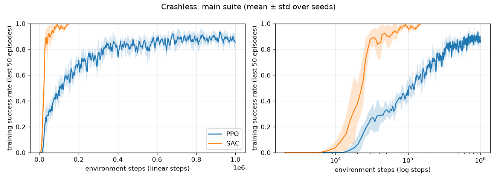

# Results: `main` suite

Deterministic policy, 100 held-out road layouts (seeds 1,000,000+) per trained model. Values are mean ± std across training seeds.

| Variant | Algo | Seeds | Train steps | Wall-clock s | Success | Collision | Off-road | Abs lateral (m) | Speed m/s | Abs steer change | Steps to 80% train success |
|---|---|---|---|---|---|---|---|---|---|---|---|
| final | PPO | 5 | 1,000,000 | 111 | 93% ± 2% | 7% ± 2% | 0% ± 0% | 0.41 ± 0.03 | 14.1 ± 0.0 | 0.077 ± 0.012 | 242k (5/5 seeds) |
| final | SAC | 5 | 150,000 | 354 | 98% ± 2% | 2% ± 2% | 0% ± 0% | 0.68 ± 0.12 | 13.4 ± 0.7 | 0.090 ± 0.023 | 25k (5/5 seeds) |

Reference controllers on the same 100 layouts:

| Controller | Success | Collision | Off-road | Abs lateral (m) | Speed m/s | Abs steer change |
|---|---|---|---|---|---|---|
| random | 0% | 2% | 98% | 1.23 | 4.5 | 0.672 |
| lane-follow PD (no obstacle sensing) | 7% | 93% | 0% | 0.57 | 8.4 | 0.029 |

