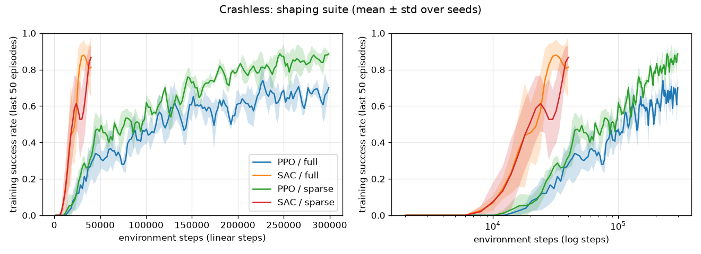

# Results: `shaping` suite

Deterministic policy, 100 held-out road layouts (seeds 1,000,000+) per trained model. Values are mean ± std across training seeds.

| Variant | Algo | Seeds | Train steps | Wall-clock s | Success | Collision | Off-road | Abs lateral (m) | Speed m/s | Abs steer change | Steps to 80% train success |
|---|---|---|---|---|---|---|---|---|---|---|---|
| full | PPO | 3 | 300,000 | 43 | 93% ± 2% | 7% ± 2% | 0% ± 0% | 0.47 ± 0.01 | 13.9 ± 0.3 | 0.133 ± 0.005 | 245k (2/3 seeds) |
| full | SAC | 3 | 40,000 | 104 | 89% ± 11% | 11% ± 11% | 0% ± 0% | 0.88 ± 0.22 | 13.5 ± 0.4 | 0.120 ± 0.027 | 23k (3/3 seeds) |
| sparse | PPO | 3 | 300,000 | 40 | 97% ± 0% | 3% ± 0% | 0% ± 0% | 0.43 ± 0.01 | 13.9 ± 0.2 | 0.441 ± 0.066 | 166k (3/3 seeds) |
| sparse | SAC | 3 | 40,000 | 103 | 76% ± 28% | 14% ± 16% | 0% ± 0% | 1.19 ± 0.34 | 9.8 ± 3.4 | 0.631 ± 0.190 | 30k (2/3 seeds) |

