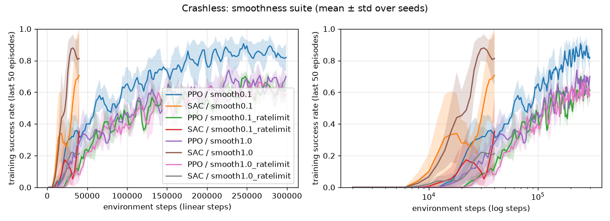

# Results: `smoothness` suite

Deterministic policy, 100 held-out road layouts (seeds 1,000,000+) per trained model. Values are mean ± std across training seeds.

| Variant | Algo | Seeds | Train steps | Wall-clock s | Success | Collision | Off-road | Abs lateral (m) | Speed m/s | Abs steer change | Steps to 80% train success |
|---|---|---|---|---|---|---|---|---|---|---|---|
| smooth0.1 | PPO | 3 | 300,000 | 40 | 96% ± 1% | 4% ± 1% | 0% ± 0% | 0.41 ± 0.04 | 14.0 ± 0.1 | 0.568 ± 0.375 | 139k (3/3 seeds) |
| smooth0.1 | SAC | 3 | 40,000 | 125 | 68% ± 41% | 9% ± 9% | 0% ± 0% | 1.30 ± 0.30 | 9.8 ± 5.0 | 0.403 ± 0.167 | 36k (2/3 seeds) |
| smooth0.1_ratelimit | PPO | 3 | 300,000 | 40 | 71% ± 2% | 29% ± 2% | 0% ± 0% | 0.62 ± 0.01 | 13.7 ± 0.3 | 0.135 ± 0.001 | never |
| smooth0.1_ratelimit | SAC | 3 | 40,000 | 126 | 36% ± 26% | 29% ± 20% | 0% ± 0% | 1.11 ± 0.13 | 6.3 ± 4.5 | 0.129 ± 0.012 | never |
| smooth1.0 | PPO | 3 | 300,000 | 40 | 93% ± 2% | 7% ± 2% | 0% ± 0% | 0.47 ± 0.01 | 13.9 ± 0.3 | 0.133 ± 0.005 | 245k (2/3 seeds) |
| smooth1.0 | SAC | 3 | 40,000 | 125 | 89% ± 11% | 11% ± 11% | 0% ± 0% | 0.88 ± 0.22 | 13.5 ± 0.4 | 0.120 ± 0.027 | 23k (3/3 seeds) |
| smooth1.0_ratelimit | PPO | 3 | 300,000 | 33 | 70% ± 1% | 29% ± 2% | 1% ± 0% | 0.64 ± 0.01 | 13.6 ± 0.4 | 0.137 ± 0.001 | never |
| smooth1.0_ratelimit | SAC | 3 | 40,000 | 109 | 23% ± 31% | 23% ± 5% | 1% ± 2% | 1.07 ± 0.15 | 4.2 ± 4.1 | 0.115 ± 0.017 | never |

